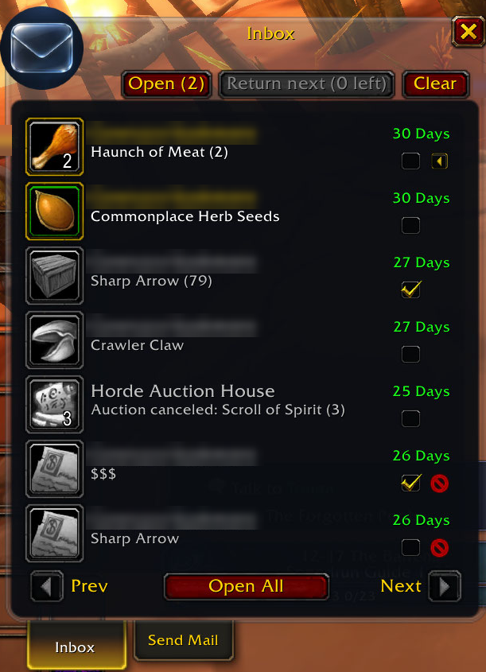
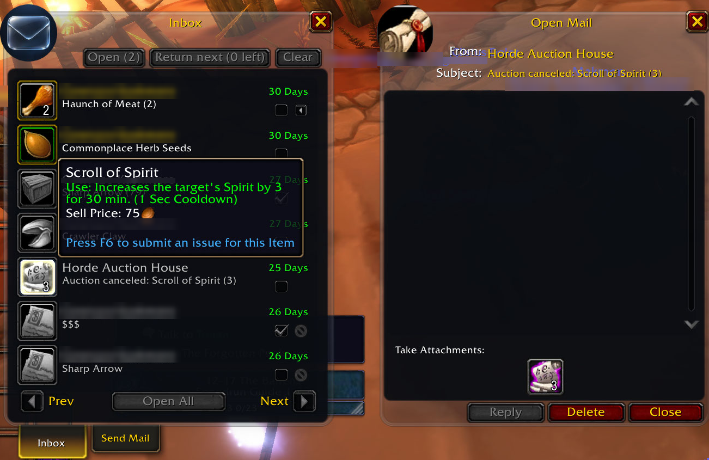
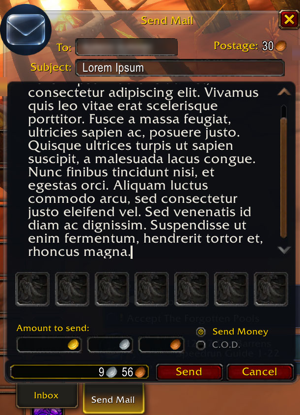

# Glass Mail

A mailbox addon for **World of Warcraft: Forever**, in the liquid-glass look of the Glass addons.
It keeps Blizzard's mail windows and adds what the mailbox is missing: Open All with filters,
checkboxes to select mail, and tooltips that list every attachment.

## Install

Install **Glass Mail** from [CurseForge](https://www.curseforge.com/wow/addons/glass-mail), either
with the CurseForge app or by unzipping it into the `Interface\AddOns` folder inside your Forever
game folder. Then `/reload`, or start the game. Visit a mailbox: there is nothing else to open.

## What it does

**Two glass looks**, clear and smoked, or Blizzard's own art. The look changes live, from the
options page or `/gmail skin`. Under glass the letters are dark too, with light text.

**Open All with filters.** Glass Mail's Open All takes the place of Blizzard's button. Right-click
it to choose what it opens: Auction House, system and player mail, and how many bag slots to keep
free (0, 2, 5 or 10). It takes the money first, then each attachment that fits (a partial stack or
a matching special bag counts as room). COD and GM mail are left for you. It stops when you close
the mailbox, enter combat or take mail by hand, and prints one line with what it took and what
it left.

**Select mail.** Each row has a checkbox: shift-click selects a range, ctrl-click everything from
that sender. Then **Open** the selection, or **Return next**, one mail per click.

**Row extras.** Each row has a Return icon, or a Delete icon when the mail is empty, so nothing
with money or items is ever deleted. Its tooltip lists every attachment and the full subject.

**At the mailbox:**
- the gold Open All collected, in one chat line when you close the mailbox;
- trades are blocked while the mailbox is open, through the game's own Block Trades setting,
  and put back as they were when you leave. `/gmail tradeblock` says who is blocking trades
  right now, and if the setting can't be put back, a chat line says so and where to turn it off;
- one chat line with the senders when new mail arrives while you're away from the mailbox.

## Commands

| Command | What it does |
|---|---|
| `/gmail help` | List the commands |
| `/gmail skin clear` / `smoked` / `stock` | The mailbox's look |
| `/gmail tradeblock on` / `off` | Block trades while the mailbox is open (on by default) |
| `/gmail tradeblock` | Who is blocking trades right now |
| `/gmail alert on` / `off` | A chat line when new mail comes (on by default) |
| `/gmail options` | Open the options page (Esc > Options > AddOns > Glass Mail) |
| `/gmail version` | The addon's version and the client build |

`/glassmail` works too.

## Planned

An inbox view of all your attachments, an address book of your characters and contacts, a memory
of every character's mailbox you can browse from anywhere, a history of what you sent where, and
help sending to your bank character. The full list is in [docs/FEATURES.md](docs/FEATURES.md).

## Reporting a problem

Open an issue on [GitHub](https://github.com/Spotnick2/GlassMail/issues) with what you did, what
you expected and what happened instead, plus the line from `/gmail version`.

Lua errors are hidden by default on this client. If something seems broken, type
`/console scriptErrors 1` and do it again; the error text is the most useful thing you can send.

## Development

- Tests: `pwsh tests/run.ps1` (Lua 5.1, needs a LibGlass checkout at `..\LibGlass` or
  `$env:LIBGLASS`).
- Deploy a dev copy: `pwsh Tools/deploy.ps1 -Probe`.
- [CLAUDE.md](CLAUDE.md) has the conventions, [docs/PLAN.md](docs/PLAN.md) the milestones, and
  [docs/FOREVER-PROBE.md](docs/FOREVER-PROBE.md) what was measured on the live client.

## Licence

MIT, see [LICENSE](LICENSE). The embedded LibGlass-1.0 is MIT too, under its own licence.
