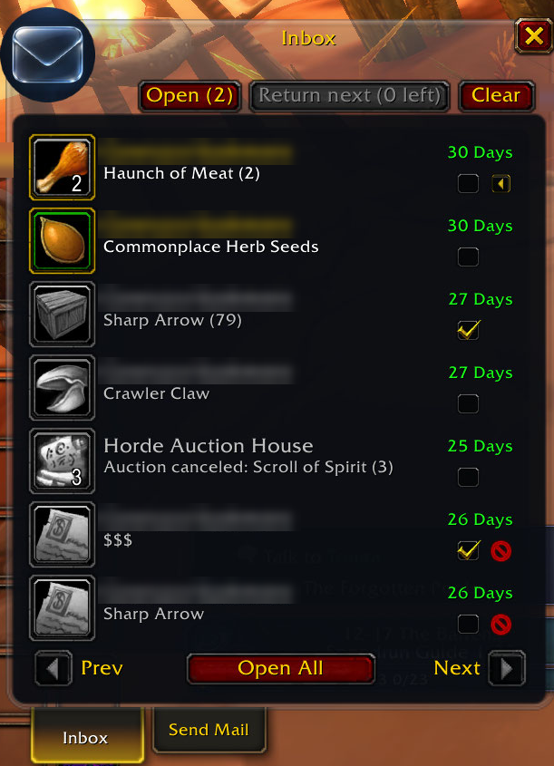
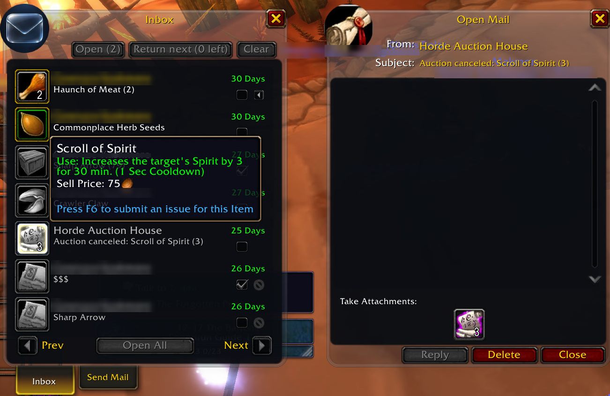
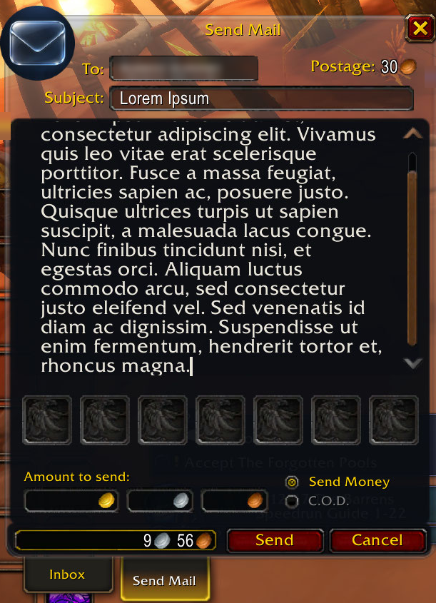

# Glass Mail

**Less clicking. Less digging. More adventuring.**

Auction sales to collect? Materials scattered across a dozen letters? Can't remember which alt you
sent that item to?

**Glass Mail** makes everyday mail easier in **World of Warcraft: Forever**. Looking for a
**Postal alternative**? It brings familiar mailbox conveniences, plus an item grid, searchable
mail records and a view of what's waiting on your alts, with optional liquid glass styling.

## What it does

**Your mailbox, unpacked.** One grid beside the inbox shows every item in your mailbox. Identical
items are grouped with their total count, so you can spot what you need and click to collect
every copy. Money, other items and COD mail stay where they are.

**"Which character did I send that to?"** The Glass Mail window keeps Sent, Inbox and Trash
records you can search by name, character, subject or item. Open it anywhere with `/gmail mail`.
- **Sent:** everything you send or return with Glass Mail installed: to whom, from which
  character, when, what it carried, and whether the game confirmed it.
- **Inbox:** each of your characters' mailboxes as you last saw it, on this WoW account: what
  holds items or gold, how much gold, and when the first mail expires. It's a record you can read
  anywhere; you still visit that character's mailbox to collect it.
- **Trash:** mail you deleted, kept as a record until it would have expired. It can't restore it.

A character's Inbox record updates each time you open its mailbox.

**Sent it to the wrong alt?** In Sent, the arrow on a mail marks it "recall" (mail with items or
gold to one of your characters on this WoW account that has logged in with Glass Mail). The row
then says whether the mail was last seen in that character's mailbox. When that character next
opens a mailbox, the mail is highlighted and a Return button under the mail window sends it back
in one click. If two mails could be it, both are highlighted and you choose.

**Collect what you want.** Open All has filters for Auction House, system and player mail, and
can keep 0, 2, 5 or 10 bag slots free. Or tick individual mails: shift-click selects a range,
ctrl-click everything from that sender, then Open the selection or Return it one mail at a time.
COD and GM mail are left for you to handle.

**Your alts are in the address book.** A searchable list from the Send tab's title bar: your characters that
can receive mail from the one you're on (same faction and ruleset, any realm), recent recipients,
friends and guildmates, each in their class colour. The To box can also start with the last name
this character mailed, so repeat sends need no typing. With **AltStable** loaded, the list also
includes the characters AltStable knows are yours, including those on your other WoW accounts
once AltStable has synced them, and typing the start of one of their names in the To box
completes it, the way the game completes the names it knows.

**A bank character.** Name one of your characters as the bank for each faction and ruleset, and
say what goes there on the Bank page of the Glass Mail window (`/gmail bank`): drop an item on it,
or add a category such as Cloth, Herb or Metal & Stone, each with how many to keep. At the mailbox,
a chat line says what is ready; on the Send tab, the bank button on the title bar fills an empty
mail with up to 12 stacks and the bank's name. You check it and press Send, then click again for
the next mail. To keep exactly that many, it first splits the stacks it needs (one click,
"Prepare"). Soulbound items stay, and Glass Mail never sends anything itself.

**Make yourself at home.** Choose clear glass, smoked glass or Blizzard's original look, or let
**Glass UI** set it for all your Glass addons (its glass, its tint, changed live, and its accent); the
mailbox keeps its familiar layout either way, empty or not: under glass, each row has a faint slot
for its icon, and an empty inbox says "No mail". Each row gets a tooltip listing its attachments,
a Return shortcut, and a Delete shortcut on empty mail only, so nothing with money or items is
deleted by accident. You also get a chat line with the gold collected when you leave, a new-mail
alert while you're away, and trades blocked while you're at the mailbox.

**Nothing piles up.** Names you stop mailing, alts you stop playing and old Sent records are
forgotten after 30 days of play (7 to 90, your choice); days you don't play don't count. A mail
leaves the records when it would have expired.

*Tick the mails you want, then open or return them in one go.*

*Every row's tooltip lists what's attached, before you open a thing.*

*Under glass, letters are dark with light text.*

## Install

Install **Glass Mail** from [CurseForge](https://www.curseforge.com/wow/addons/glass-mail) with
the CurseForge app, or from [Wago Addons](https://addons.wago.io/addons/glassmail) with the Wago
app. Both keep it up to date. Or download the zip from
[GitHub Releases](https://github.com/Spotnick2/GlassMail/releases) and unzip it into the
`Interface\AddOns` folder inside your Forever game folder. Then `/reload`, or start the game.

## Getting started

Visit a mailbox: everything is there. Use `/gmail options` to customise it, `/gmail mail` to
browse your records, or `/gmail help` for every command.

| Command | What it does |
|---|---|
| `/gmail help` | List the commands |
| `/gmail mail` | The Glass Mail window: Sent, Inbox, Trash |
| `/gmail options` | Open the options page (Esc > Options > AddOns > Glass Mail) |
| `/gmail skin clear` / `smoked` / `stock` | The mailbox's look (with Glass UI, `/gmail skin suite` follows its look again) |
| `/gmail guides on` / `off` | Under glass, the inbox's empty slots, row lines and "No mail" (on by default) |
| `/gmail autofill on` / `off` | Start the To box with the last name this character mailed (on by default) |
| `/gmail bank` | The bank character and what goes to it |
| `/gmail banknotice on` / `off` | A chat line at the mailbox when items are ready for the bank (on by default) |
| `/gmail alert on` / `off` | A chat line when new mail comes (on by default) |
| `/gmail tradeblock on` / `off` | Block trades while the mailbox is open (on by default) |
| `/gmail tradeblock` | Who is blocking trades right now |
| `/gmail expiry 7` / `14` / `30` / `60` / `90` | Play days before an unused name or record is forgotten (30) |
| `/gmail recents 10` / `20` / `50` | How many recent recipients are kept (20) |
| `/gmail version` | The addon's version and the client build |

`/glassmail` works too.

## Planned

Later, maybe: Drafts and Spam folders, recalling mail across your WoW accounts, and Forward. The
full list is in [docs/FEATURES.md](docs/FEATURES.md).

## Reporting a problem

Found a problem or have an idea? Open an issue on
[GitHub](https://github.com/Spotnick2/GlassMail/issues) with what you did, what you expected and
what happened instead, plus the line from `/gmail version`.

Lua errors are hidden by default on this client. If something seems broken, type
`/console scriptErrors 1` and do it again; the error text is the most useful thing you can send.

## Development

- Tests: `pwsh tests/run.ps1` (Lua 5.1, needs LibGlass and LibMailbox checkouts at `..\LibGlass` and
  `..\LibMailbox`, or `$env:LIBGLASS` / `$env:LIBMAILBOX`).
- Deploy a dev copy: `pwsh Tools/deploy.ps1 -Probe`.
- [CLAUDE.md](CLAUDE.md) has the conventions, [docs/PLAN.md](docs/PLAN.md) the milestones, and
  [docs/FOREVER-PROBE.md](docs/FOREVER-PROBE.md) what was measured on the live client.

## Licence

MIT, see [LICENSE](LICENSE). The embedded LibGlass-1.0 and LibMailbox-1.0 are MIT too, under their own
licences.
Glass Mail is an independent addon, not affiliated with Postal.
